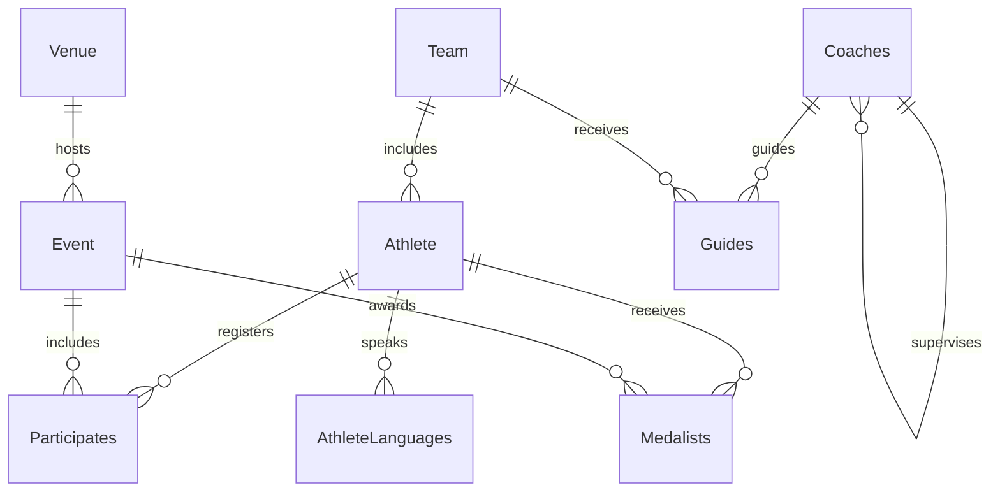

# Olympics Database Management System

**ISYS2014 — Database Systems | Curtin University | Semester 2, 2024**  
**Project type:** Individual university coursework  
**Technologies:** MySQL, SQL, Python, `mysql-connector-python`

## Overview

This repository documents an Olympics-themed relational database project. I developed SQL scripts for the database schema, data insertion and retrieval, and database features such as stored procedures, a trigger and a view. I also wrote a Python script to connect to MySQL, execute queries, and perform insert, update and delete operations.

**Coursework adaptation:** The included files were reorganised for portfolio use. Student-ID comments were removed and the database name was consistently changed to `OlympicsDBS_Portfolio`. The original project was not otherwise independently re-implemented here. This is an academic demonstration, not a production application.

## Features backed by the submitted code

- **10 database tables:** `Team`, `Athlete`, `AthleteLanguages`, `Event`, `Venue`, `Participates`, `Medalists`, `Coaches`, `Guides`, and `TechnicalOfficials`.
- Primary and foreign keys, including composite keys for many-to-many relationships.
- **14 SELECT examples** using filters, joins, self-joins, date calculations, aggregates and ordering.
- **2 stored procedures:** `AddAthlete` and `CategorizeExperience`.
- **1 BEFORE UPDATE trigger:** `beforeVenueUpdate`, which rejects venue capacities below 40,000.
- **1 view:** `AthleteParticipation`, joining participation, athlete and event data.
- Python–MySQL integration using environment-supplied database credentials, including query execution and CRUD operations.

## Database relationship sketch

`TechnicalOfficials` is another standalone table in the schema. The relationship sketch is simplified; see `sql/create_tables.sql` for actual key definitions.

## Repository files

| File | Purpose |
| --- | --- |
| `sql/create_database.sql` | Creates the MySQL database (drops a database of the same name first). |
| `sql/create_tables.sql` | Defines the 10 tables and their keys. |
| `sql/insert_data.sql` | Original coursework dataset, included only for private review. |
| `sql/queries.sql` | SELECT queries, stored procedures, trigger and view. |
| `sql/run_all_scripts.sql` | MySQL client helper for running table, data and query scripts. |
| `python/connectionDBS.py` | Python database query and CRUD demonstration. |
| `docs/project-case-study.md` | Project description suitable for portfolio review. |
| `docs/validation-and-safety.md` | What was verified and what was not tested. |

## Setup notes

1. Use a **local disposable MySQL instance**; do not use a real or shared database.
2. Install the Python connector with `pip install -r requirements.txt`.
3. Run `sql/create_database.sql`, `sql/create_tables.sql` and `sql/insert_data.sql` in that order, specifying `OlympicsDBS_Portfolio` for the latter scripts.
4. **Review `sql/queries.sql` before running it:** it contains an intentionally invalid venue-capacity update to demonstrate the trigger, so a database error is expected at that statement. Some queries and mutations change sample data.
5. Set `DBS_USER` and `DBS_PASS` in the environment, then run `python/connectionDBS.py` only after reviewing its INSERT/UPDATE/DELETE operations.

The source is retained as an educational artefact. Scripts have **not** been rerun against MySQL for this portfolio, and there is no claim of production hardening.

## Sharing and privacy

Keep this repository **private** until university sharing rules and the dataset's redistribution rights have been checked. This package includes original bulk sample records. Do not publish real database passwords or `.env` files. The `create_database.sql` file contains `DROP DATABASE IF EXISTS` and must not be run on an important database.

## Relation to cybersecurity

The project demonstrates relational data modelling, SQL query construction, credential handling through environment variables, and database interaction from Python. It is a **database programming project**, not a penetration-testing exercise or a deployed security system.
